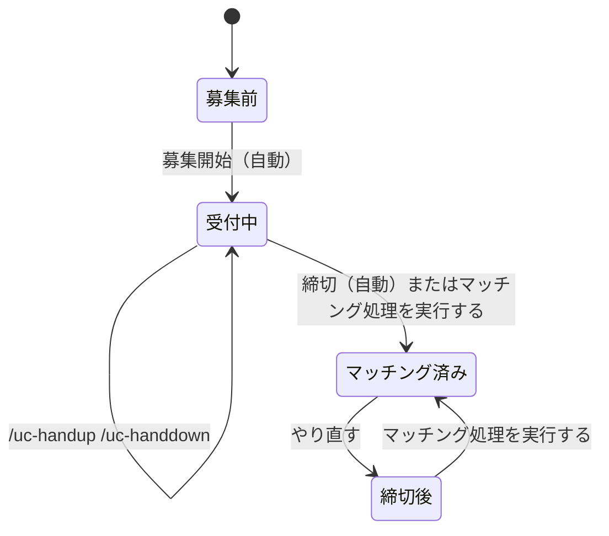

このページは、運営が運用するときと、参加者の質問に答えるときに使うまとめ。まず「運営の運用フロー」を読む。

## 運営の運用フロー

運営の仕事は、準備（最初に 1 回）・毎日・大会の区切りの 3 つ。毎日のうち自動で動く部分は、運営は何もしない。

1 つの対戦枠（ある日のある試合時刻）は、次のように進む。矢印の名前が、状態を動かす操作。

下の表は、状態ごとに使うコマンドと画面をまとめたもの。上から順に読むと 1 日の流れになる。

| 状態 | どういう状態か | 使うもの |
|---|---|---|
| 募集前 | 募集の投稿が出る前 | `/uc-status` で自チームの挙手状況を見られる |
| 受付中 | 挙手を受け付けている | 参加者は `/uc-handup` で挙手し `/uc-handdown` で取り消す。運営はダッシュボードの「対戦枠」で代わりに追加と取り消しができる。`/uc-admin-status` で全チームの挙手を見られる |
| マッチング済み | 挙手が 2 チームずつに組まれた。結果はチャンネルに投稿される | ダッシュボードの「対戦枠」で組分けを追加・削除できる |
| 締切後 | 締切を過ぎたのに、まだ組まれていない。「やり直す」のあともこの状態になる | ダッシュボードの「対戦枠」で「マッチング処理を実行する」を押す。自動では組まれない |

状態に関係なく使うコマンドは `/uc-admin-dashboard`。ダッシュボードにログインするリンクを出す。

運営の仕事の中心は、締切のあとに組分けが出ているかを確かめること。それ以外は、困ったときだけ操作すればよい。

### 準備（最初に 1 回）

1. Bot をサーバーに招待する。
2. Discord の管理者権限を持つ人が `/uc-admin-dashboard` を実行して、ダッシュボードにログインする。
3. 「設定」で、投稿先のチャンネル ID・試合時刻・募集開始時刻・締切を決める。Bot がそのチャンネルに投稿できることも確かめる。
4. 「チーム」で、参加するチームを追加する。Discord のロールを選ぶ。
5. 参加者にロールを付ける。1 人に付けるチームのロールは 1 つだけ。

### 毎日

| 時刻 | 誰が | やること |
|---|---|---|
| 募集開始（既定は 12:00） | 自動 | チャンネルに募集の投稿が出る |
| 募集開始から締切まで | 参加者 | `/uc-handup` で挙手する。取り消しは `/uc-handdown` |
| 締切（既定は試合の 7 分前） | 自動 | 挙手が 2 チームずつに組まれ、結果がチャンネルに投稿される |

締切の前後には、次の確認をしておくとよい。

- 締切の前に、「対戦枠」で挙手の数を見る。0〜1 チームだと組分けはできない。
- 締切の後に、「対戦枠」で組分けが出ているか見る。出ていなければ「困ったとき」を見る。

### 困ったとき

| こうなった | やること |
|---|---|
| 募集の投稿が出ない | 「設定」の投稿先のチャンネル ID を確認する。Bot がそのチャンネルに投稿できるかも確認する |
| 締切を過ぎても組分けが出ない | 「対戦枠」で「マッチング処理を実行する」を押す |
| 組分けを間違えた | 「やり直す」で戻して、もう一度「マッチング処理を実行する」を押す。組分けだけを直すなら、その組分けを削除して追加し直す |
| 参加者が挙手も取り消しもできない | 受付の時間外か、マッチング済み。運営が「対戦枠」で代わりに挙手を追加か取り消しをする。マッチング済みなら先に「やり直す」を実行する |

## 用語

| 用語 | 意味 |
|---|---|
| 管理者 | Discord で Administrator の権限を持つ人。管理者のコマンドと、ダッシュボードへのログインは、管理者だけが使える |
| 試合時刻 | 試合を行う時刻（例: 21 時）。設定で登録する |
| 対戦枠 | ある日のある試合時刻（例: 10/09 の 21:00）。挙手と組分けは対戦枠ごとに管理する |
| 挙手 | チームが「この対戦枠に出る」と手を挙げること |
| マッチング | 挙手したチームを 2 チームずつの組に分けること。締切の時刻に自動で行う |
| 組分け | マッチングで決まった 2 チームの対戦 |
| 組まれなかったチーム | 挙手が奇数のとき、最後に挙手して組に入れなかったチーム |
| 主催 | 組分けの 2 チームのうち、マリオカートの部屋を立てる側。組分けを作るときに、2 チームから無作為に決まる。結果の投稿と、ダッシュボードの組分けの行に出る（決まったあとは、変わらない） |
| 何試合目 | そのチームが入った組分けの順番（そのチームが、これまでに何回、組分けに入ったか）。勝ち負けには関係しない。マッチング結果の投稿・`/uc-status`・ダッシュボードの組分けの行に出る。組分けを足したり削除したりすると、数え直される |

## 参加者向け: コマンド

{{commands}}

コマンドの返信は、実行した本人にだけ見える。

### 挙手できないとき

次のどれかに当てはまる。

- 受付の時間ではない（募集開始の前か、締切の後）。
- その対戦枠は、すでにマッチングが済んでいる。
- 同じチームが、同じ時刻にすでに挙手している。
- チームのロールを、ちょうど 1 つ持っていない（持っていない、または 2 つ以上持っている）。

### 取り消せないとき

締切の後（マッチング済み）は取り消せない。運営が、ダッシュボードの「対戦枠」で「やり直す」を実行すると、マッチングが取り消されて、挙手を取り消せるようになる。

### 状況を知りたいとき

- 自分のチームの挙手状況は `/uc-status`。
- マッチングの結果はチャンネルに投稿される。組分けごとに、各チームの何試合目か（そのチームの、これまでの試合数）と、主催（部屋を立てる側）も書いてある。挙手が奇数のときは、最後に挙手したチームが組まれない。

## 運営向け: ダッシュボード

### ログイン

Discord で管理者が `/uc-admin-dashboard` を実行すると、ログイン用のリンクが届く。リンクは 1 回だけ使え、1 時間で無効になる。ログインした端末は 7 日間有効。リンクは他の人に共有しない。

### 対戦枠（入口）

日付ごと（◀ ▶ と「今日」）に対戦枠が並ぶ。

- 状態: 未マッチング（受付の段階つき）・マッチング済み・削除済み。
- 挙手: 代理で追加と取り消しができる。マッチング済みの対戦枠ではできない。
- マッチング処理を実行する: 締切を待たず、いまマッチングする。結果は Discord に投稿される。
- やり直す: マッチング済みの対戦枠の、組分けを削除して、未マッチングに戻す。挙手は残る。Discord にキャンセルを投稿するかは、確認のときに選べる。元には戻せない。
- 組分け: 2 チームを選んで追加できる。両チームの挙手は自動で付く。削除もできる。

### チーム

チームの一覧に、挙手中（今日）が出る。

- チームは、Discord のロールを選んで追加する。名前はロールの名前を使う。
- 削除しても、過去の組分けは残る。同じロールを追加し直すと元に戻る。

### 設定

- 投稿先のチャンネル: 募集開始とマッチング結果を投稿するチャンネルの ID。空にすると投稿しない。
- 募集開始時刻と締切（試合の何分前か）。変えるときは、変更をチャンネルに知らせるかを、確認される（初期は、知らせる）。打ち間違いをすぐ直すときは、チェックを外す。
- 募集開始の通知先: 募集開始の投稿で、誰に通知するか。「なし」（既定）・「チーム全て」（登録済みのチームのロール）・「ロールを選ぶ」（選んだロールと `@here`）。変更の知らせにも、同じ通知先が使われる。
- 試合時刻: 追加と削除ができる。削除すると、その時刻の対戦枠は「削除済み」になり、挙手とマッチングは行われなくなる。同じ時刻を追加し直すと元に戻る。
- ログイン: ログインリンクを再発行したとき、これまでのログインをすべて失効させるかを選べる。
- ログイン中の端末: 一覧と失効ができる。

## 想定される質問

### 参加者からの質問

#### 挙手できない。
次のどれかを確認する。受付の時間（募集開始から締切まで）か。その時刻の対戦枠が、すでにマッチング済みでないか。チームのロールをちょうど 1 つ持っているか。直らなければ、運営がダッシュボードの「対戦枠」で代わりに挙手を追加する。

#### 挙手を取り消したい。
締切の前なら `/uc-handdown` で取り消せる。締切の後（マッチング済み）は取り消せないので運営に頼む。運営は「やり直す」で戻してから、挙手を取り消す。

#### 挙手したのに組まれなかった。
挙手したチームが奇数のときは、最後に挙手したチームだけが組まれない。挙手が 1 チームだけのときも組めない。結果はチャンネルの投稿に出る。

#### 対戦相手はどこで分かる？
締切のときにチャンネルへ投稿される結果で分かる。主催（部屋を立てる側）も、同じ投稿に書いてある。

#### コマンドを実行しても反応しない。
サーバー内で実行する。DM では使えない。管理者のコマンドは、既定では管理者にだけ表示される。Bot がサーバーにいるかも確認する。

#### コマンドの返信が、ほかの人に見えない。
返信は、実行した本人にだけ見える仕様。

### 運営の操作

#### 組分けを間違えた。
「対戦枠」でその組分けを削除し、正しい 2 チームで追加し直す。

#### マッチングをやり直したい。
「対戦枠」で「やり直す」を実行する。組分けは消えて、挙手だけが残る。そのあと「マッチング処理を実行する」でもう一度マッチングする。

#### 締切を過ぎてもマッチングされない。
「対戦枠」で「マッチング処理を実行する」を押す。それでも結果の投稿が出ないときは、「設定」の投稿先のチャンネル ID と、Bot がそのチャンネルに投稿できるかを確認する。

#### 募集や結果がチャンネルに投稿されない。
「設定」の「投稿先のチャンネル ID」が空か間違っていないか確認する。Bot に、そのチャンネルの閲覧と投稿の権限があるかも確認する。

#### 募集開始の時刻を、間違えていた。
「設定」の「募集開始時刻」を直して、保存する。確認の画面で、チャンネルに変更を知らせるかを選べる。
- 前にずらしたとき（すでに過ぎた時刻にしたとき）: 知らせると、「すでに募集は始まっています」と添えた投稿が出る。この投稿が、募集開始の投稿を兼ねる。受付は、時刻で開くので、すぐ挙手できる。
- 後ろにずらしたとき: 新しい時刻まで、受付が閉じる。今日の挙手は、残るが、新しい時刻まで取り消せない（確認の画面に、件数が出る）。新しい時刻になると、募集開始の投稿が、もう一度出る。

#### 募集開始の通知が、参加者に届かなかった。
同じ時刻のままでは、もう一度は出せない。「通知先」の設定（なし・チーム全て・ロールを選ぶ）を、確かめて、募集開始の時刻を、ずらして保存すると、変更の知らせと、新しい時刻の投稿が出る。

#### 試合時刻を増やしたい・減らしたい。
「設定」の試合時刻で追加と削除ができる。削除すると、その時刻の対戦枠は「削除済み」になり、挙手とマッチングは行われなくなる。過去の記録は残る。同じ時刻を追加し直すと元に戻る。

#### チームを追加したい・削除したい。
「チーム」で、Discord のロールを選んで追加する。削除しても、過去の組分けは残る。

### ログインの質問

#### ダッシュボードに入れない。
ログインのリンクは 1 回だけ使え、1 時間で無効になる。もう一度、管理者が `/uc-admin-dashboard` を実行して、新しいリンクを出す。

#### ログインした端末を締め出したい。
「設定」の「ログイン中の端末」で、その端末を失効する。すべてを失効することもできる。
