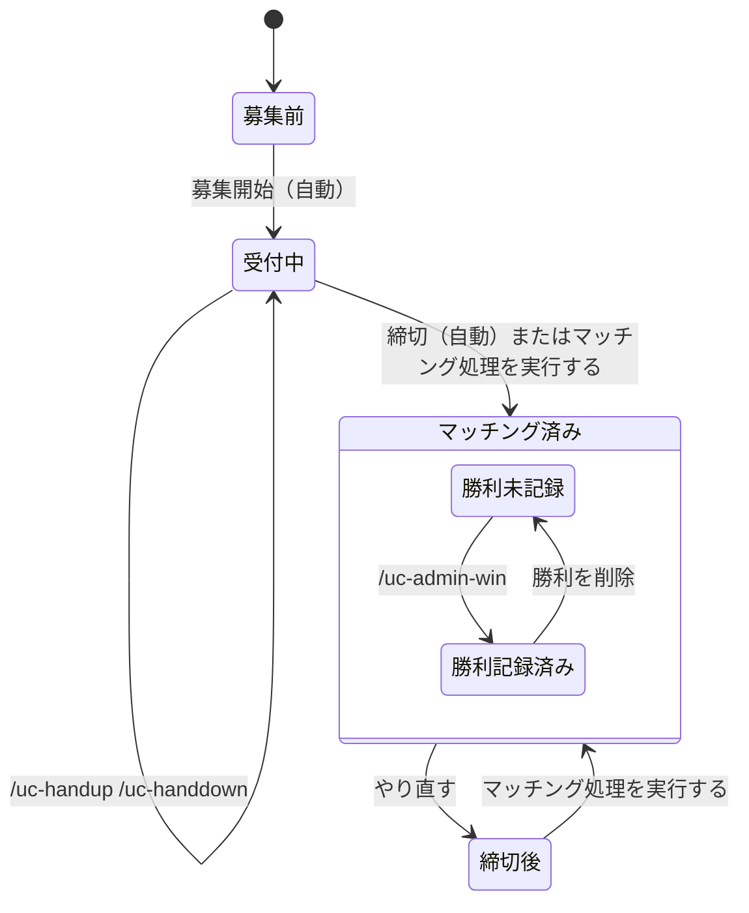

このページは、運営が運用するときと、参加者の質問に答えるときに使うまとめ。まず「運営の運用フロー」を読む。

## 運営の運用フロー

運営の仕事は、準備（最初に 1 回）・毎日・大会の区切りの 3 つ。毎日のうち自動で動く部分は、運営は何もしない。

1 つの対戦枠（ある日のある試合時刻）は、次のように進む。矢印の名前が、状態を動かす操作。

下の表は、状態ごとに使うコマンドと画面をまとめたもの。上から順に読むと 1 日の流れになる。

| 状態 | どういう状態か | 使うもの |
|---|---|---|
| 募集前 | 募集の投稿が出る前 | `/uc-status` で自チームの挙手状況を見られる |
| 受付中 | 挙手を受け付けている | 参加者は `/uc-handup` で挙手し `/uc-handdown` で取り消す。運営はダッシュボードの「対戦枠」で代わりに追加と取り消しができる。`/uc-admin-status` で全チームの挙手を見られる |
| マッチング済み | 挙手が 2 チームずつに組まれた。結果はチャンネルに投稿される | `/uc-teams` で得点を見る。ダッシュボードの「対戦枠」で組分けを追加・削除できる |
| └ 勝利未記録 | 組まれたが勝利がまだ記録されていない | 運営が `/uc-admin-win` かダッシュボードの「対戦枠」で勝利を記録する。残っていると、メニューの「勝利記録」に赤い点が付く |
| └ 勝利記録済み | 勝利が記録された。得点に入る | 間違えたときは、ダッシュボードで点数を直すか、勝利を削除して記録し直す |
| 締切後 | 締切を過ぎたのに、まだ組まれていない。「やり直す」のあともこの状態になる | ダッシュボードの「対戦枠」で「マッチング処理を実行する」を押す。自動では組まれない |

状態に関係なく使うコマンドは次の 2 つ。

- `/uc-admin-dashboard`: ダッシュボードにログインするリンクを出す。
- `/uc-admin-score-clear`: すべてのチームの得点と勝利の履歴、組分けを消す。確認のボタンが出る。大会の区切りで使う。

運営の仕事の中心は、勝利未記録を 0 件にすること。それ以外は、困ったときだけ操作すればよい。

### 準備（最初に 1 回）

1. Bot をサーバーに招待する。
2. Discord の管理者権限を持つ人が `/uc-admin-dashboard` を実行して、ダッシュボードにログインする。
3. 「設定」で、投稿先のチャンネル ID・試合時刻・募集開始時刻・締切を決める。Bot がそのチャンネルに投稿できることも確かめる。
4. 「チーム」で、参加するチームを追加する。Discord のロールを選ぶ。
5. 参加者にロールを付ける。1 人に付けるチームのロールは 1 つだけ。

### 毎日

| 時刻 | 誰が | やること |
|---|---|---|
| 募集開始（既定は 12:00） | 自動 | チャンネルに募集の投稿が出る |
| 募集開始から締切まで | 参加者 | `/uc-handup` で挙手する。取り消しは `/uc-handdown` |
| 締切（既定は試合の 7 分前） | 自動 | 挙手が 2 チームずつに組まれ、結果がチャンネルに投稿される |
| 試合が終わったら | 運営 | 勝利を記録する（下の手順） |
| 1 日の終わり | 運営 | 「勝利記録」の赤い点が消えていることを確認する |

締切の前後には、次の確認をしておくとよい。

- 締切の前に、「対戦枠」で挙手の数を見る。0〜1 チームだと組分けはできない。
- 締切の後に、「対戦枠」で組分けが出ているか見る。出ていなければ「困ったとき」を見る。

### 勝利を記録する手順

1. 参加者から結果の画像（PNG・JPEG・WebP）を受け取る。
2. 次のどちらかで記録する。
   - Discord で `/uc-admin-win` を実行する。時刻・勝ったチームのロール・点数・画像を入れる。試合が始まった後でないと使えない。
   - ダッシュボードの「対戦枠」で、その組分けの行から追加する。いつでも記録できる。
3. 「勝利記録」の「勝利が未記録の組分け」が空になったことを確認する。

### 大会の区切り（週の終わりなど）

1. `/uc-teams` かダッシュボードの「チーム」で得点を確認し、参加者に伝える。
2. 次の大会を始めるときは、「勝利記録」の「得点をクリアする」を実行する。勝利と試合数がすべて消え、元には戻せない。

### 困ったとき

| こうなった | やること |
|---|---|
| 募集の投稿が出ない | 「設定」の投稿先のチャンネル ID を確認する。Bot がそのチャンネルに投稿できるかも確認する |
| 締切を過ぎても組分けが出ない | 「対戦枠」で「マッチング処理を実行する」を押す |
| 組分けを間違えた | 「やり直す」で戻して、もう一度「マッチング処理を実行する」を押す。組分けだけを直すなら、その組分けを削除して追加し直す |
| 参加者が挙手も取り消しもできない | 受付の時間外か、マッチング済み。運営が「対戦枠」で代わりに挙手を追加か取り消しをする。マッチング済みなら先に「やり直す」を実行する |
| 勝利の点数や画像を間違えた | 「想定される質問」を見る |

## 用語

| 用語 | 意味 |
|---|---|
| 管理者 | Discord で Administrator の権限を持つ人。管理者のコマンドと、ダッシュボードへのログインは、管理者だけが使える |
| 試合時刻 | 試合を行う時刻（例: 21 時）。設定で登録する |
| 対戦枠 | ある日のある試合時刻（例: 10/09 の 21:00）。挙手と組分けは対戦枠ごとに管理する |
| 挙手 | チームが「この対戦枠に出る」と手を挙げること |
| マッチング | 挙手したチームを 2 チームずつの組に分けること。締切の時刻に自動で行う |
| 組分け | マッチングで決まった 2 チームの対戦 |
| 組まれなかったチーム | 挙手が奇数のとき、最後に挙手して組に入れなかったチーム |
| 勝利 | 組分けの結果の記録。勝ったチーム・点数・画像を残す |
| N・固定点 | 得点の数え方に使う設定（「得点の数え方」を参照） |

## 参加者向け: コマンド

{{commands}}

コマンドの返信は、実行した本人にだけ見える。

### 挙手できないとき

次のどれかに当てはまる。

- 受付の時間ではない（募集開始の前か、締切の後）。
- その対戦枠は、すでにマッチングが済んでいる。
- 同じチームが、同じ時刻にすでに挙手している。
- チームのロールを、ちょうど 1 つ持っていない（持っていない、または 2 つ以上持っている）。

### 取り消せないとき

締切の後（マッチング済み）は取り消せない。運営が、ダッシュボードの「対戦枠」で「やり直す」を実行すると、マッチングが取り消されて、挙手を取り消せるようになる。

### 状況を知りたいとき

- 自分のチームの挙手と得点は `/uc-status`。
- 全チームの得点は `/uc-teams`。
- マッチングの結果はチャンネルに投稿される。挙手が奇数のときは、最後に挙手したチームが組まれない。

## 運営向け: ダッシュボード

### ログイン

Discord で管理者が `/uc-admin-dashboard` を実行すると、ログイン用のリンクが届く。リンクは 1 回だけ使え、1 時間で無効になる。ログインした端末は 7 日間有効。リンクは他の人に共有しない。

### 対戦枠（入口）

日付ごと（◀ ▶ と「今日」）に対戦枠が並ぶ。

- 状態: 未マッチング（受付の段階つき）・マッチング済み・削除済み。
- 挙手: 代理で追加と取り消しができる。マッチング済みの対戦枠ではできない。
- マッチング処理を実行する: 締切を待たず、いまマッチングする。結果は Discord に投稿される。
- やり直す: マッチング済みの対戦枠の、組分けと勝利（画像を含む）を削除して、未マッチングに戻す。挙手は残る。Discord にキャンセルを投稿するかは、確認のときに選べる。元には戻せない。
- 組分け: 2 チームを選んで追加できる。両チームの挙手は自動で付く。削除もできる。
- 勝利: 組分けの行から、勝ったチーム・点数・画像を入れて追加する。点数だけの間違いは「点数を編集」で直せる。それ以外の間違いは、削除して記録し直す。

### チーム

得点表に、順位・挙手中（今日）・得点・試合数・勝利数が出る。行を押すと、そのチームの全組分けが下に開く。

- チームは、Discord のロールを選んで追加する。名前はロールの名前を使う。
- 削除しても、過去の組分けと勝利は残る。同じロールを追加し直すと元に戻る。

### 勝利記録

- 勝利が未記録の組分け: マッチング済みで試合の開始時刻を過ぎているのに、勝利が記録されていない組分けの一覧。ある間は、メニューの「勝利記録」に赤い点が付く。
- 履歴: 削除した記録も残る。「元に戻す」で数え直される。チーム・日付・記録者で絞り込める。
- 得点をクリアする: すべてのチームの勝利と組分け（試合数）を削除する。元には戻せない。

### 設定

- 投稿先のチャンネル: 募集開始とマッチング結果を投稿するチャンネルの ID。空にすると投稿しない。
- 募集開始時刻と締切（試合の何分前か）。
- N と固定点: 得点の数え方（次の節を参照）。
- 試合時刻: 追加と削除ができる。削除すると、その時刻の対戦枠は「削除済み」になり、挙手とマッチングは行われなくなる。同じ時刻を追加し直すと元に戻る。
- ログイン: ログインリンクを再発行したとき、これまでのログインをすべて失効させるかを選べる。
- ログイン中の端末: 一覧と失効ができる。

## 得点の数え方

- 試合数は、そのチームが入った組分けの数。勝ち負けには関係しない。対戦枠の日付と時刻の順に、1 試合目、2 試合目と数える。
- N 試合目までに勝つと、記録した点数がそのまま得点になる。
- N 試合を超えた試合（N+1 試合目から）に勝つと、記録した点数にかかわらず固定点になる。
- 負けた試合は得点に入らない。試合数には数える。
- 勝利の記録を削除しても組分けは残るので、何試合目かは変わらない。

例: N が 5、固定点が 100 のとき

| 試合 | 結果 | 記録した点数 | 得点 |
|---|---|---|---|
| 3 試合目 | 勝ち | 80 | 80 |
| 5 試合目 | 勝ち | 120 | 120 |
| 6 試合目 | 勝ち | 80 | 100（固定点） |
| 7 試合目 | 負け | | 0 |

## 想定される質問

### 参加者からの質問

#### 挙手できない。
次のどれかを確認する。受付の時間（募集開始から締切まで）か。その時刻の対戦枠が、すでにマッチング済みでないか。チームのロールをちょうど 1 つ持っているか。直らなければ、運営がダッシュボードの「対戦枠」で代わりに挙手を追加する。

#### 挙手を取り消したい。
締切の前なら `/uc-handdown` で取り消せる。締切の後（マッチング済み）は取り消せないので運営に頼む。運営は「やり直す」で戻してから、挙手を取り消す。

#### 挙手したのに組まれなかった。
挙手したチームが奇数のときは、最後に挙手したチームだけが組まれない。挙手が 1 チームだけのときも組めない。結果はチャンネルの投稿に出る。

#### 対戦相手はどこで分かる？
締切のときにチャンネルへ投稿される結果で分かる。

#### 自分のチームの得点が、思った点数と違う。
N 試合を超えた勝利は、記録した点数ではなく固定点になる（「得点の数え方」を参照）。負けた試合は得点に入らない。勝利がまだ記録されていない場合もあるので、運営が「勝利記録」の「勝利が未記録の組分け」を確認する。

#### 試合数が、勝った数と合わない。
試合数は組分けに入った数で、勝ち負けに関係しない。

#### コマンドを実行しても反応しない。
サーバー内で実行する。DM では使えない。管理者のコマンドは、既定では管理者にだけ表示される。Bot がサーバーにいるかも確認する。

#### コマンドの返信が、ほかの人に見えない。
返信は、実行した本人にだけ見える仕様。

### 運営の操作

#### 点数を間違えて記録した。
勝利の行の「点数を編集」で直す。画像を間違えたときは、その勝利を削除して記録し直す。

#### 勝利のチームや日付を間違えて記録した。
その勝利を削除して、正しい組分けに記録し直す。`/uc-admin-win` で日付を指定するときは、`date` に `YYYY-MM-DD` を入れる。

#### 勝利を二重に記録してしまった。
1 つの組分けに有効な勝利は 1 件までなので、2 件目は記録できない。間違えたほうを削除して記録し直す。

#### 画像を付けられない。
画像は PNG・JPEG・WebP で 8MB 以下。形式が違うときは変換してもらう。拡張子だけ変えたファイルは、中身を見て断る。

#### `/uc-admin-win` が使えない。
その対戦枠がマッチング済みで、試合の開始時刻を過ぎていないと使えない。日付の打ち間違いを止めるため。急ぐときは、ダッシュボードから記録する。こちらはいつでも記録できる。

#### 組分けを間違えた。
「対戦枠」でその組分けを削除し、正しい 2 チームで追加し直す。勝利も一緒に消える。

#### マッチングをやり直したい。
「対戦枠」で「やり直す」を実行する。組分けと勝利は消えて、挙手だけが残る。そのあと「マッチング処理を実行する」でもう一度マッチングする。

#### 締切を過ぎてもマッチングされない。
「対戦枠」で「マッチング処理を実行する」を押す。それでも結果の投稿が出ないときは、「設定」の投稿先のチャンネル ID と、Bot がそのチャンネルに投稿できるかを確認する。

#### 募集や結果がチャンネルに投稿されない。
「設定」の「投稿先のチャンネル ID」が空か間違っていないか確認する。Bot に、そのチャンネルの閲覧と投稿の権限があるかも確認する。

#### 試合時刻を増やしたい・減らしたい。
「設定」の試合時刻で追加と削除ができる。削除すると、その時刻の対戦枠は「削除済み」になり、挙手とマッチングは行われなくなる。過去の記録は残る。同じ時刻を追加し直すと元に戻る。

#### チームを追加したい・削除したい。
「チーム」で、Discord のロールを選んで追加する。削除しても、過去の組分けと勝利は残る。

#### 勝利の記録が足りているか確認したい。
「勝利記録」の「勝利が未記録の組分け」を見る。空なら記録はそろっている。メニューの「勝利記録」の赤い点が消えていても分かる。

#### 得点を最初からやり直したい。
「勝利記録」の「得点をクリアする」を実行する。勝利と試合数がすべて消え、元には戻せない。

### ログインの質問

#### ダッシュボードに入れない。
ログインのリンクは 1 回だけ使え、1 時間で無効になる。もう一度、管理者が `/uc-admin-dashboard` を実行して、新しいリンクを出す。

#### ログインした端末を締め出したい。
「設定」の「ログイン中の端末」で、その端末を失効する。すべてを失効することもできる。
