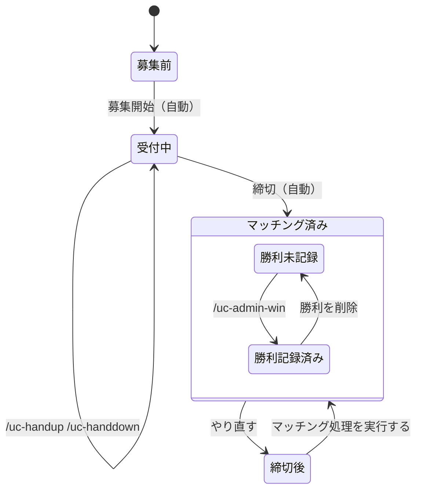

このページは、運営が運用するときと、参加者の質問に答えるときに使う、使い方のまとめです。まずは「運営の運用フロー」を読んでください。

## 運営の運用フロー

運営がやることは、**準備**（最初に 1 回）・**毎日**・**大会の区切り**の 3 つです。毎日のうち、自動で動く部分は、運営は何もしません。

1 つの対戦枠（ある日の、ある試合時刻）は、次のように進みます。矢印の名前が、その状態を動かす操作です。（自動）は、何もしなくても進みます。

下の表は、状態ごとに、使うコマンドと画面をまとめたものです。上から順に読むと、1 日の流れになります。

| 状態 | どういう状態か | 使うもの |
|---|---|---|
| 募集前 | 募集の投稿が出る前 | （なし）。`/uc-status` で、挙手の状況を見られる |
| 受付中 | 挙手を受け付けている | 参加者は `/uc-handup` で挙手し、`/uc-handdown` で取り消す。運営は、ダッシュボードの「対戦枠」で、代わりに追加と取り消しができる。`/uc-admin-status` で、全チームの挙手を見られる |
| マッチング済み | 締切で、挙手が 2 チームずつに組まれた（結果は、チャンネルに投稿される） | `/uc-teams` で得点を見る。ダッシュボードの「対戦枠」で、組分けを追加・削除できる |
| 　勝利未記録 | 組まれたが、勝利がまだ記録されていない | 運営が、`/uc-admin-win` か、ダッシュボードの「対戦枠」で、勝利を記録する（`/uc-admin-win` は、試合が始まった後だけ）。残っていると、メニューの「勝利記録」に、赤い点が付く |
| 　勝利記録済み | 勝利が記録された。得点に入る | 間違えたときは、ダッシュボードで、点数を直すか、勝利を削除して、記録し直す |
| 締切後 | 締切を過ぎているのに、まだ組まれていない。「やり直す」のあとも、この状態になる | ダッシュボードの「対戦枠」で、**「マッチング処理を実行する」**を押す。自動では、組まれない |

そのほかのコマンドは、状態に関係なく使います。

- `/uc-admin-dashboard`: ダッシュボードにログインするリンクを出す。
- `/uc-admin-score-clear`: すべてのチームの得点を消す（大会の区切りで使う）。

運営の仕事は、**勝利未記録を 0 件にすること**です（残っていると、メニューの「勝利記録」に赤い点が付きます）。それ以外は、困ったときだけ操作します。

### 準備（最初に 1 回）

1. Bot をサーバーに招待する。
2. 管理者が `/uc-admin-dashboard` を実行して、ダッシュボードにログインする。
3. 「設定」で、**投稿先のチャンネル ID**・**試合時刻**・募集開始時刻・締切を決める。
4. 「チーム」で、参加するチームを（Discord のロールを選んで）追加する。
5. 参加者に、ロールを付ける。**1 人につき、チームのロールは 1 つだけ**。

### 毎日

| 時刻 | 誰が | やること |
|---|---|---|
| 募集開始（既定は 12:00） | 自動 | チャンネルに募集の投稿が出る |
| 募集開始から締切まで | 参加者 | `/uc-handup` で挙手する。取り消しは `/uc-handdown` |
| 締切（既定は試合の 7 分前） | 自動 | 挙手が 2 チームずつに組まれて、結果がチャンネルに投稿される |
| 試合が終わったら | **運営** | **勝利を記録する**（下の手順） |
| 1 日の終わり | 運営 | 「勝利記録」の赤い点が消えていることを確認する |

運営が確認しておくとよいのは、次の 2 つです。

- 締切の前に、「対戦枠」で、挙手の数を見る。0〜1 チームだと、組分けはできない。
- 締切の後に、「対戦枠」で、組分けが出ているか見る。出ていなければ、「困ったとき」を見る。

### 勝利を記録する手順

1. 参加者から、結果の画像（PNG・JPEG・WebP）を受け取る。
2. 記録する。次のどちらでもよい。
   - Discord で `/uc-admin-win`（時刻・勝ったチームのロール・点数・画像を入れる。試合が始まった後でないと使えない）
   - ダッシュボードの「対戦枠」で、その組分けの行から追加する（いつでも記録できる）
3. 「勝利記録」の**「勝利が未記録の組分け」**が空になったことを確認する（残っていると、メニューの「勝利記録」に赤い点が付く）。

### 大会の区切り（週の終わりなど）

1. `/uc-teams` か、ダッシュボードの「チーム」で、得点を確認して、参加者に伝える。
2. 次の大会を始めるときは、「勝利記録」の**「得点をクリアする」**を実行する（勝利と試合数がすべて消える。元に戻せない）。

### 困ったとき

| こうなった | やること |
|---|---|
| 募集の投稿が出ない | 「設定」の投稿先のチャンネル ID を確認する |
| 締切を過ぎても、組分けが出ない | 「対戦枠」で、**「マッチング処理を実行する」**を押す |
| 組分けを間違えた | 「やり直す」で戻して、もう一度「マッチング処理を実行する」を押す（細かい直し方は、「想定される質問」） |
| 参加者が、挙手も取り消しもできない | 締切を過ぎている。運営が代わりに、「対戦枠」で挙手を追加か取り消しをする（マッチング済みなら、先に「やり直す」） |
| 勝利の点数や画像を間違えた | 「想定される質問」を見る |

## 用語

| 用語 | 意味 |
|---|---|
| 試合時刻 | 試合を行う時刻（例: 21時）。設定で登録する |
| 対戦枠 | ある日のある試合時刻（例: 10/09 の 21:00）。挙手と組分けは、対戦枠ごとに管理する |
| 挙手 | チームが「この対戦枠に出る」と手を挙げること |
| マッチング | 挙手したチームを、2チームずつの組に分けること。締切の時刻に自動で行う |
| 組分け | マッチングで決まった、2チームの対戦 |
| 組まれなかったチーム | 挙手が奇数のとき、最後に挙手して、組に入れなかったチーム |
| 勝利 | 組分けの結果の記録。勝ったチーム・点数・画像を残す |
| N・固定点 | 得点の数え方に使う設定（下の「得点の数え方」を参照） |

## 参加者向け: コマンド

{{commands}}

コマンドの返信は、実行した本人にだけ見える。

### 挙手できないとき

次のどれかに当てはまる。

- 受付の時間ではない（募集開始の前か、締切の後）。
- その対戦枠は、すでにマッチングが済んでいる。
- すでに、同じチームで、同じ時刻に挙手している。
- チームのロールを、ちょうど 1 つ持っていない（持っていない、または 2 つ以上持っている）。

### 取り消せないとき

締切の後（マッチング済み）は、取り消せない。運営が、ダッシュボードの「対戦枠」で、「やり直す」を実行すると、マッチングが取り消されて、挙手を取り消せるようになる。

### 状況を知りたいとき

- 自分のチームの挙手と得点は `/uc-status`。
- 全チームの得点は `/uc-teams`。
- マッチングの結果は、チャンネルに投稿される。挙手が奇数のとき、最後に挙手したチームは、組まれない。

## 運営向け: ダッシュボード

### ログイン

Discord で、管理者が `/uc-admin-dashboard` を実行すると、ログイン用のリンクが届く。リンクは、1 回だけ使えて、1 時間で無効になる。ログインした端末は、7 日間有効。リンクは、他の人に共有しない。

### 対戦枠（入口）

日付ごと（◀ ▶ と「今日」）に、対戦枠が並ぶ。

- **状態**: 未マッチング（受付の段階つき）・マッチング済み・削除済み。
- **挙手**: 代理で追加と取り消しができる（マッチング済みの対戦枠は、できない）。
- **マッチング処理を実行する**: 締切を待たずに、いま、マッチングする。結果は Discord に投稿される。
- **やり直す**: マッチング済みの対戦枠の、組分けと勝利（画像を含む）を削除して、未マッチングに戻す。挙手は残る。Discord にキャンセルを投稿するかは、確認のときに選べる。元に戻せない。
- **組分け**: 2 チームを選んで追加できる（両チームの挙手は、自動で付く）。削除もできる。
- **勝利**: 組分けの行から、勝ったチーム・点数・画像を入れて追加する。点数だけの間違いは、「点数を編集」で直せる。間違った記録は、削除して、記録し直す。

### チーム

得点表に、順位・挙手中（今日）・得点・試合数・勝利数が出る。行を押すと、そのチームの全組分けが、下に開く。

- チームは、Discord のロールを選んで追加する。名前は、ロールの名前を使う。
- 削除しても、過去の組分けと勝利は残る。同じロールを追加し直すと、元に戻る。

### 勝利記録

- **勝利が未記録の組分け**: マッチング済みで、試合の開始時刻を過ぎているのに、勝利が記録されていない組分けの一覧。ある間は、メニューの「勝利記録」に、赤い点が付く。
- **履歴**: 削除した記録も残っている。「元に戻す」で、数え直される。チーム・日付・記録者で絞り込める。
- **得点をクリアする**: すべてのチームの勝利と組分け（試合数）を削除する。元に戻せない。

### 設定

- **投稿先のチャンネル**: 募集開始とマッチング結果を投稿するチャンネルの ID。
- **募集開始時刻**と**締切**（試合の何分前か）。
- **N**と**固定点**: 得点の数え方（下を参照）。
- **試合時刻**: 追加と削除ができる。削除すると、その時刻の対戦枠は「削除済み」になって、挙手とマッチングは行われなくなる。同じ時刻を追加し直すと元に戻る。
- **ログイン中の端末**: 一覧と、失効ができる。

## 得点の数え方

- **試合数**は、そのチームが入った組分けの数。勝ち負けには関係しない。試合は、対戦枠の日付と時刻の順に、1 試合目、2 試合目と数える。
- **N 試合目まで**に勝つと、記録した点数が、そのまま得点になる。
- **N 試合を超えた試合**（N+1 試合目から）に勝つと、記録した点数に関係なく、**固定点**になる。
- 負けた試合は、得点に入らない（試合数には数える）。
- 勝利の記録を削除しても、組分けは残るので、試合数（何試合目か）は変わらない。

例: N が 5、固定点が 100 のとき

| 試合 | 結果 | 記録した点数 | 得点 |
|---|---|---|---|
| 3 試合目 | 勝ち | 80 | 80 |
| 5 試合目 | 勝ち | 120 | 120 |
| 6 試合目 | 勝ち | 80 | 100（固定点） |
| 7 試合目 | 負け | | 0 |

## 想定される質問

### 参加者からの質問

**挙手できない。**
次のどれかを確認する。受付の時間（募集開始から締切まで）か。その時刻の対戦枠が、すでにマッチング済みでないか。チームのロールを、ちょうど 1 つ持っているか。直らなければ、運営が、ダッシュボードの「対戦枠」で、代わりに挙手を追加する。

**挙手を取り消したい。**
締切の前なら、`/uc-handdown` で取り消せる。締切の後（マッチング済み）は、取り消せないので、運営に頼む。運営は、「やり直す」で戻してから、挙手を取り消す。

**挙手したのに、組まれなかった。**
挙手したチームが奇数のとき、最後に挙手したチームだけが、組まれない。挙手が 1 チームだけのときも、組めない。マッチングの結果は、チャンネルの投稿に出る。

**対戦相手は、どこで分かる？**
締切のときに、チャンネルへ投稿される結果で分かる。

**自分のチームの得点が、思った点数と違う。**
記録した点数ではなく、**N 試合を超えた勝利は、固定点**になる（「得点の数え方」を参照）。負けた試合は、得点に入らない。勝利が、まだ記録されていない場合もある。運営が、「勝利記録」の「勝利が未記録の組分け」を確認する。

**試合数が、勝った数と合わない。**
試合数は、組分けに入った数で、勝ち負けに関係しない。

**コマンドを実行しても、反応しない。**
サーバー内で実行する（DM では使えない）。管理者のコマンドは、管理者にだけ表示される。Bot がサーバーにいるかも確認する。

**コマンドの返信が、ほかの人に見えない。**
返信は、実行した本人にだけ見える仕様。

### 運営の操作

**点数を間違えて記録した。**
勝利の行の「点数を編集」で直す。画像を間違えたときは、その勝利を削除して、記録し直す。

**勝利のチームや日付を間違えて記録した。**
その勝利を削除して、正しい組分けに、記録し直す。`/uc-admin-win` で日付を指定するときは、`date` に `YYYY-MM-DD` を入れる。

**勝利を二重に記録してしまった。**
1 つの組分けに、有効な勝利は 1 件までなので、2 件目は、記録できない。間違えた方を削除して、記録し直す。

**画像を付けられない。**
画像は、PNG・JPEG・WebP で、8MB 以下。形式が違うときは、変換してもらう。拡張子だけ変えたファイルは、中身を見て、断る。

**`/uc-admin-win` が使えない。**
試合の対戦枠が、マッチング済みで、試合の開始時刻を過ぎていないと、使えない。日付の打ち間違いを止めるため。急ぐときは、ダッシュボードから記録する（こちらは、いつでも記録できる）。

**組分けを間違えた。**
「対戦枠」で、その組分けを削除して、正しい 2 チームで追加し直す。勝利も一緒に消える。

**マッチングをやり直したい。**
「対戦枠」で、「やり直す」を実行する。組分けと勝利は消えて、挙手だけが残る。そのあと、「マッチング処理を実行する」で、もう一度マッチングする。

**締切を過ぎても、マッチングされない。**
「対戦枠」で、「マッチング処理を実行する」を押す。それでも結果の投稿が出ないときは、「設定」の投稿先のチャンネル ID と、Bot がそのチャンネルに投稿できるかを確認する。

**募集や結果が、チャンネルに投稿されない。**
「設定」の「投稿先のチャンネル ID」が、空か、間違っていないか確認する。Bot に、そのチャンネルの閲覧と投稿の権限があるかも確認する。

**試合時刻を増やしたい・減らしたい。**
「設定」の試合時刻で、追加と削除ができる。削除すると、その時刻の対戦枠は「削除済み」になって、挙手とマッチングは、行われなくなる。過去の記録は残る。同じ時刻を追加し直すと、元に戻る。

**チームを追加したい・削除したい。**
「チーム」で、Discord のロールを選んで追加する。削除しても、過去の組分けと勝利は残る。

**勝利の記録が、足りているか確認したい。**
「勝利記録」の「勝利が未記録の組分け」を見る。空なら、記録は、そろっている。メニューの「勝利記録」の赤い点が、消えていても分かる。

**得点を、最初からやり直したい。**
「勝利記録」の「得点をクリアする」。勝利と試合数が、すべて消える。元に戻せない。

### ログインの質問

**ダッシュボードに、入れない。**
ログインのリンクは、1 回だけ使えて、1 時間で無効になる。もう一度、管理者が `/uc-admin-dashboard` を実行して、新しいリンクを出す。

**ログインした端末を、締め出したい。**
「設定」の「ログイン中の端末」で、その端末を失効する（すべてを失効することもできる）。
